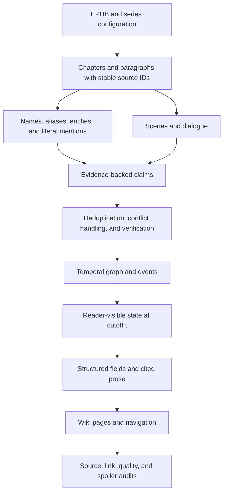

# How this project reached its current state

**Audit narrative, as of 26 September 2026.** This is a retrospective of the recorded work, not a new benchmark run. The latest phase is **Phase 31, still in progress**. The headline six-book Anne experiment is paused before completion. Historical results below retain their original corpus, denominator, and limitations.

- Picture identification fails
- Consistency is not maintained (Overlord, Ainz level)

**Read this together with [the complete numerical evidence appendix](PROJECT_LIFELINE_METRICS.md).** That appendix preserves the measurement ledger and a phase-by-phase catalogue of numerical passages, including costs, counts, test results, rejected experiments, and corrections. The narrative explains the consequential numbers; the appendix prevents the smaller numbers from disappearing. The authoritative evolving ledger remains [MEASUREMENTS.md](MEASUREMENTS.md).

## Contents

1. [The project in ordinary language](#1-the-project-in-ordinary-language)
2. [How to interpret the measurements](#2-how-to-interpret-the-measurements)
3. [Phases 0–8: building the machinery](#3-phases-08-building-the-machinery)
4. [Phases 9–13: making a real run controllable](#4-phases-913-making-a-real-run-controllable)
5. [Phases 17–21: from shallow facts to narrative evidence](#5-phases-1721-from-shallow-facts-to-narrative-evidence)
6. [Phases 22–23: plausible prose is not supported prose](#6-phases-2223-plausible-prose-is-not-supported-prose)
7. [Phase 24: auditing the scientific claim itself](#7-phase-24-auditing-the-scientific-claim-itself)
8. [Phases 25–27: traceable evidence and honest evaluation](#8-phases-2527-traceable-evidence-and-honest-evaluation)
9. [Phase 28: stronger models and controlled comparisons](#9-phase-28-stronger-models-and-controlled-comparisons)
10. [Phases 29–30: making the graph reach the reader](#10-phases-2930-making-the-graph-reach-the-reader)
11. [Dataset evolution](#11-dataset-evolution)
12. [Phase 31: memorisation, renaming, and paraphrasing](#12-phase-31-memorisation-renaming-and-paraphrasing)
13. [Research lineage and what was actually adopted](#13-research-lineage-and-what-was-actually-adopted)
14. [Current condition and remaining work](#14-current-condition-and-remaining-work)
15. [An audit presentation you can give](#15-an-audit-presentation-you-can-give)
16. [Evidence, limitations, and reproduction](#16-evidence-limitations-and-reproduction)

## 1. The project in ordinary language

The project builds a **source-cited wiki that changes with a reader's progress through a novel**. A reader at volume 1 should see what the text has established by volume 1, even if the system has ingested later volumes. The wiki should also be useful: a perfectly blank page would avoid spoilers but fail the purpose of the project.

Imagine a librarian preparing character dossiers. Each fact is an index card with a source quotation, a paragraph address, and the point in the story where the reader learns it. The librarian may write readable summaries, but only after selecting the cards the reader is allowed to see. Relationships, dates, names, and other structured fields should come from those cards, rather than being invented during writing.

This analogy explains the project's successive discoveries:

- **The scanner can lose pages.** EPUB parsing sometimes silently discarded chapters or entire books.
- **The name index can join two people.** A shared surname could merge relatives into one entity.
- **A card can misread its quotation.** A quotation can be authentic while the attached claim is false.
- **The filing system can confuse change with contradiction.** Someone having two roles is not necessarily an extraction error.
- **The librarian can select the wrong cards.** A volume-1 fact can carry a volume-2 quotation; a rejected fact can still reach a prose prompt through another route.
- **The writer can omit good cards.** The graph can contain skills and backstory that never appear on the page.
- **The inspector can score the wrong thing.** Seeing two character names together is not proof that the page disclosed a future relationship.
- **The writer may already know the book.** Filtering the cards does not erase the language model's training-time memory.

The project therefore evolved from **a local extraction pipeline**, to **a readable, temporally filtered wiki**, to **a system with explicit evidence and evaluation controls**, and finally to **an unfinished publication experiment separating retrieval leakage from model memory**.

### The working pipeline

This is a conceptual map, not a claim that every planned schema migration is complete. In particular, the later observation-semantics work has a shadow representation and migration gates; it has not replaced every legacy graph path.

The foundational rule is **filter before generation**. However, the history shows why this rule alone is insufficient: filtering must cover names, quotations, events, relationships, prompts, links, search, and model-memory effects. The incentive was always to provide more useful information **without moving the reader beyond their place in the story**.

### A worked example of the intended behaviour

Consider an invented merchant, Mira, and a guild leader, Rowan. This is an explanatory example, not a measured case from the novels.

- Volume 1 establishes that Mira trades cloth and works with Rowan. Those claims carry volume-1 paragraph IDs and quotations.
- Volume 2 reveals that Rowan betrayed Mira years earlier. The event happened earlier in the fictional world's chronology, but the **reader learns it in volume 2**. It must not appear on the volume-1 wiki.
- A second volume-2 quotation confirms Mira's cloth trade. The trade itself is safe at cutoff 1, but this later quotation still is not. The page must cite its volume-1 evidence.
- Mira stops working with Rowan in volume 2. A volume-1 page must not expose the later endpoint, or announce “this relationship ends later.” At cutoff 2, the historical cooperation may still belong in History even if it is no longer a current affiliation.
- A character jokes, “Rowan practically adopted Mira.” A real quotation does not make Rowan her literal parent. The claim needs interpretation and verification before publication.

This separates **story time**, **reader discovery time**, **evidence availability**, and **current versus historical state**. They are related but not interchangeable. The early interval model covered only part of this problem; the later observation-semantics work exists because collapsing these distinctions produced errors.

“Structured fields are never LLM-generated” means the **published fields are assembled deterministically from accepted graph rows**. Models can still propose the underlying candidate facts during extraction. The rule prevents the final prose writer from improvising a new age, spouse, or affiliation; it does not make an incorrectly extracted graph row true by definition.

The two caches also answer different questions. The model cache reuses an answer for the same provider/model/prompt/parameters, while page caching asks whether a page's relevant evidence changed. A cache hit saves spending and helps reproducibility. It is not an independent second sample that strengthens a statistical claim.

## 2. How to interpret the measurements

Before presenting any percentage, say **what was counted, over which corpus and cutoff, and by which scorer**. Many apparent contradictions in the history disappear when these are specified.

| Term | Meaning in this project | What it does not establish |
|---|---|---|
| Entity/roster yield | Characters receiving some extracted facts | Complete character coverage or fact recall |
| Paragraph coverage | Eligible source paragraphs exposed to an extraction stage | That all their facts were extracted correctly |
| Gold-fact recall | Expected, in-scope facts credited on generated pages | Recall over every fact in the novels |
| Macro recall | Average of character-level recall values | A pooled total; large and small characters receive equal weight |
| Negative-control precision | Absence of selected, known bad assertions, scored by the local evaluator | Human precision over all assertions on all pages |
| Supported/unsupported verdict | The verifier's decision on an extracted fact | Ground truth; verifier changes produced both false releases and false withholdings |
| Citation/link coverage | Claims/pages have source links, or links resolve | That the linked text entails the claim |
| Candidate/index leakage | A full-corpus preprocessing result differs from a cutoff-only result, or exposes a future surface | A reader has necessarily learned a future event |
| Disclosure rate | A generated artifact contains a form unavailable at the cutoff under a specified matching rule | Semantic future-fact leakage; exact and normalised matching differ |
| Lexical “findable” leak | A later claim can be matched lexically in an earlier page | That the matched words express that later claim |
| Future-fact page leak | Specified future gold facts are asserted on a page at an earlier cutoff | Zero leakage outside that finite gold set |
| Control recall in a leak test | Known early facts retained while future facts are tested | General factual recall on the whole series |
| Cloze accuracy | Recovering a hidden original name from a passage | Automatic transfer of later plot facts to a wiki page |
| Source recognition | Identifying the original book/author | Identity disclosure in the generated page, unless the page actually says it |
| Identity disclosure | The output reveals a remapped character's original identity/book | Necessarily revealing a later plot event |

**Example:** a volume-1 page says “Ned Land speaks to Captain Nemo.” A future graph row says “Ned Land is a comrade of Captain Nemo.” A weak matcher may count the first sentence as a future relationship leak because both names appear. The reader has not necessarily been told the later relationship. This became a major issue in the Leagues evaluation.

**Another example:** all registered spellings of “Holo” may be found by an exact multi-pattern matcher. That is excellent literal matching, but it does not find every “she,” epithet, or implicit reference. The early “100%” literal-form recall must not be presented as 100% narrative entity recall.

For the gold-fact tests, **recall = credited in-scope gold facts / all in-scope gold facts**. Macro recall averages this fraction across characters. If one character gets 1/2 and another gets 9/10, macro recall is 70%, while pooled recall is 10/12, about 83%; these illustrative values show why the aggregation rule matters. A future-fact leak test instead divides credited future facts by the specified future gold set. Its control recall checks that early facts survived. A change from 0/25 leaks to 0/100 would cover more opportunities, but neither proves there are no other spoilers. These arithmetic examples are explanatory, not additional project measurements.

Four leakage channels were explicitly separated in the research work: **query-time retrieval**, **published artifacts**, **build-time preprocessing**, and **parametric memory**. A successful test of one channel is not a proof about the other three. [Phase 24 design](vision/PHASE_24.md); [ledger §§1–2, 43–45](MEASUREMENTS.md).

## 3. Phases 0–8: building the machinery

### Phase 0 — make the project runnable before claiming intelligence

The initial work established configuration, a command-line interface, local model access, and basic tests. The first recorded suite had **38 tests**. A doctor check could reveal that the local model service was unavailable; importing code was not treated as proof that a live model could answer.

**Why this mattered:** the project needed a reproducible pipeline, not a notebook whose outputs depended on hidden state. A fake client could test plumbing cheaply, but its output was never evidence of real extraction quality. [Phase 0](handover/PHASE_0.md).

### Phase 1 — source ingestion is part of correctness

The original corpus was **13 volumes of 86**. The ingest recorded **926,154 words**, replacing a rough estimate of about **936,000**, and the test count reached **53**. These are historical runs, not permission to use 86 now.

The parser had to follow EPUB spine order rather than filename order, keep continuation documents without headings, recognise chapter headings beyond a narrow numbered pattern, and exclude front matter appropriately. One heading correction recovered **16 rather than 14 sections**. Some volumes lacked usable print-page markers: **four volumes** could not supply something the source EPUB did not contain.

**Analogy:** extracting knowledge before validating ingest is like auditing a company using a photocopier that sometimes skips pages. No later model improvement can recover source material it was never shown.

**Origin of the fix:** inspection of the actual EPUB structure and deterministic parser tests, not a research-paper technique. This lesson returned dramatically with Anne in Phase 31. [Phase 1](handover/PHASE_1.md).

### Phase 2 — build a stable cast and name index

The system mined candidate names, classified them, clustered aliases, applied reviewed overrides, and used Aho–Corasick-style literal matching for registered forms. A capitalisation ratio of **0.75** and a minimum occurrence count of **3** were among the early candidate controls. There were **87 tests**.

Simple string similarity could not reliably connect dissimilar nicknames, and a shared string could refer to different entity types. The response was a layered alias process with contextual evidence, explicit overrides, and collision handling, rather than assuming every similar name was the same person.

The incentive was stable identity across volumes: if “Kraft Lawrence” and “Lawrence” become separate people, every subsequent count, relationship, and page is compromised. However, the early implementation did not solve all identity ambiguity; later corpus expansion exposed surname bridges and first-person family terms. [Phase 2](handover/PHASE_2.md).

### Phase 3 — turn passages into constrained claims

Extraction became subject-centred and evidence-backed: bounded windows, a target character, a quotation, and constrained predicates. Relation objects had to occur in the passage, and quotations were checked against the source. The early cap was **40 windows per character**. A fake-client smoke test used **80 calls for two characters**, with **105 tests** recorded; later real-model runs supplied actual extraction evidence.

**Failure being prevented:** a model knows a plausible fact about a character and writes it even though the supplied passage does not establish it. The first defence was source anchoring. Later phases discovered that anchoring was necessary but not sufficient: authentic words can be attached to an incorrect interpretation.

One window per request remains the default. A later attempt to pack windows saved apparent requests but damaged quality, so cost did not override evidence quality. [Phase 3](handover/PHASE_3.md).

### Phase 4 — facts need temporal identity, not just storage

Claims were consolidated into a temporal SQLite graph. A recorded run converted **130 claims into 122 intervals and 53 edges**, with **one same-volume arbitration**; the suite reached **122 tests**.

The initial distinction was useful but coarse: conflicting claims within a volume might be extraction errors, while a difference across volumes might be a genuine story change. Later work showed why a richer representation was needed: roles can coexist, dialogue can be hypothetical, and opposite relations can describe different events.

**Analogy:** “works as a merchant” and “becomes a town official” need a timeline, while “merchant” and “travelling merchant” may simply be two descriptions of the same job. An arbitrator should not erase either just because their strings differ. [Phase 4](handover/PHASE_4.md).

### Phase 5 — selecting an early fact does not make all its evidence early

Page assembly and graph retrieval applied the reader cutoff. Personalised PageRank operated over a cutoff-filtered graph. The suite reached **155 tests**.

A concrete bug showed a **volume-2 quotation in a volume-1 explanation** for a claim already known in volume 1. Filtering the claim was insufficient; each evidence item needed its own cutoff check. Future endpoint metadata also needed care: saying that a relationship “ends later” can itself spoil something.

**Fix and origin:** inspect the leaked output, trace the citation path, and filter evidence individually before rendering or prompting. This is the earliest clear example of the project expanding spoiler safety beyond a single graph predicate. [Phase 5](handover/PHASE_5.md).

### Phase 6 — readable prose, constrained by evidence and cache

The system added short, trait-driven prose with no model call when there was no evidence, and caching at both the model-response and synthesis levels. Tests reached **170**.

A practical failure was that “return JSON” did not guarantee the right schema. An explicit shape/example made the expected output concrete. This later evolved into stricter validation when silently accepting the wrong schema caused verification failures.

**Incentive:** a graph dump is difficult to read, but prose should be a presentation layer over evidence. Caching made repeated rendering affordable without pretending that reusing an answer was a new independent experiment. [Phase 6](handover/PHASE_6.md).

### Phase 7 — publish something a reader can navigate

A static hash-routed site was chosen, with snapshots, cutoff-aware links, and navigation. An early restricted build had **119 routes and zero broken references**, with **191 tests**. Sparse snapshots used the latest available state at or before the selected cutoff.

These were engineering successes, not semantic safety proofs. A working link can still reveal a future alias; a valid route can still serve a misleading page. The initial site design was later replaced with a more conventional MkDocs wiki after usability inspection. [Phase 7](handover/PHASE_7.md).

### Phase 8 — make model selection and operational failure explicit

Per-stage model overrides, provider routing, cache keys, and budget accounting made runs more inspectable. A tiny recorded arbitration call cost **$0.0000084**. Operational problems included an editable installation pointing at a stale checkout and outputs consumed by hidden reasoning/token limits.

**Why this belongs in an audit:** “the same command” can run different code or a different model unless those identities are recorded. The project increasingly treated model, prompt, configuration, and source state as part of the experiment. [Phase 8](handover/PHASE_8.md).

## 4. Phases 9–13: making a real run controllable

### Phase 9 — move to a smaller calibration corpus

Spice and Wolf volumes 1–2 became the practical calibration corpus. The recorded baseline contained **255 claims, 573 quotation records, 26 predicates, 33 entities, 210 intervals, 60 edges, and 19 conflicts**: **17 extraction errors and two story changes**. There were **14 characters**, **17 page files**, and **33 routes**.

This was a working end-to-end system, but not a satisfactory wiki. Later inspection of this period found **five of 14 characters with no facts**, and roughly **35–40 near-duplicate Holo appearance claims**. The system could produce many records while still missing the facts readers cared about.

Provider availability also shaped the work: an expired Mistral credential, Groq's roughly **8,000-token-per-minute** constraint, and a failed retry sequence of **20 retries over about 65 seconds** made resumable caching necessary. Google access at roughly **15 requests per minute** provided another constrained route. These are historical operating conditions, not present-day provider specifications.

**Incentive for the corpus change:** use a manageable two-volume story to isolate pipeline defects before paying to scale them. [Phase 9](handover/PHASE_9.md).

### Phases 10–12 — runs must leave evidence and fail honestly

The project added run directories, prompt/response records including cache hits, configuration hashes, code identity, artifact snapshots, rollback support, and guarded progression through stages. Budget persistence and volume interlocks became operational rather than merely configurable. A failed stage should not advance the workflow.

An audit that printed `FAIL` but exited successfully was another serious defect: an automated runner could treat a broken stage as successful. Exit behaviour was corrected and HTML/source traces made diagnosis more concrete. Phase 12 recorded **306 tests**.

**Analogy:** a factory warning light is not a safety interlock if the conveyor keeps moving. These changes connected the warning to the workflow.

**Origin:** observed pipeline failures and reproducibility needs. This was infrastructure for trustworthy experiments, not evidence that extraction accuracy had improved. [Phase 10](handover/PHASE_10.md), [Phase 11](handover/PHASE_11.md), [Phase 12](handover/PHASE_12.md).

### Phase 13 — define what a good page should contain

Markdown and browser code had developed separate hard-coded section orders. The fix moved outline structure into configuration and made the vocabulary/merge behaviour explicit.

The broader idea came partly from **STORM's outline-oriented article generation** and the project's wiki-quality reading: pages need an organised coverage target, not merely whatever facts happened to be easy to extract. This was an adaptation, not a reproduction of STORM's full research system. [Phase 13](handover/PHASE_13.md); [STORM](https://arxiv.org/abs/2402.14207).

### What happened to Phases 14–16?

The repository has no completed handover sequence for these numbers. Work contemplated in intermediate planning was absorbed into later phases, including ontology, evaluation, and routing work. **Do not invent three completed experiments to make the numbering continuous.** Phase numbers are historical planning labels, not a clean experimental protocol.

## 5. Phases 17–21: from shallow facts to narrative evidence

### Phase 17 — diagnose why “more claims” was not “more knowledge”

The ontology was too shallow and redundant facts crowded out useful ones. In the early Spice and Wolf output, **60 of 255 claims were APPEARANCE** and **26 were FRIEND**; Holo alone had **91 claims**. The planned richer vocabulary included **nine attributes, five traits, and 22 relations**.

Before increasing extraction, the project introduced semantic deduplication using **BGE-M3 embeddings**, with a recorded cosine threshold of **0.86**. The motivation was to consolidate paraphrases of the same fact so that extra evidence did not simply make a longer list of “silver hair” variants. The threshold was a project choice, not a validated universal boundary from the BGE paper. [BGE-M3](https://arxiv.org/abs/2402.03216).

A coverage audit exposed another bottleneck: Holo's **517 mention paragraphs** became **135 windows**, of which the cap sent only **40**. Her coverage was **33.6% of 2,587 paragraphs**, compared with **62.8%** without the cap. Lawrence showed **56.6% versus 87.5%**. These are input coverage figures, not fact recall.

**Analogy:** the system was repeatedly describing a person's coat while skipping the chapters that explained their decisions.

Fine-tuning was considered but not selected as the next step. The immediate problems were representation, source coverage, labels, and controllable spoiler boundaries. Changing model weights would not directly repair those. This was a project-specific prioritisation, not proof that fine-tuning cannot help extraction. [Phase 17 design](vision/PHASE_17.md); [handover](handover/PHASE_17.md).

### Phases 18–19 — give actions and scenes a place to live

The pipeline added fuller chapter-span coverage, scene extraction, epithets, and an event representation. Roughly **4,000-token spans** aimed at complete paragraph exposure. **100% paragraph coverage means source exposure, not 100% understanding.**

Scenes could capture who participated, what happened, quotations, and state changes; events gained their own chronology and storage. This reduced dependence on isolated, repeated character descriptions. The scene pass also supplied epithets for later alias enrichment, making stage order important.

Phase 18 initially shipped code before the full live validation. Phase 19 recorded **397 tests**. The later observation/event research did not mean the legacy interval schema had already become fully event-anchored. [Phase 18](handover/PHASE_18.md); [Phase 19](handover/PHASE_19.md).

### Phase 20 — run the richer pipeline and repair its interfaces

Live execution of the preceding additions exposed budget and rendering mismatches. A minimum budget of **25** could conflict with a maximum of **6** and needed clamping. Quote output needed clearer examples and canonical entity resolution. A **900-character** prose cap could discard useful chronology; later work moved toward actual sentence enforcement.

The model could still write **12–14 sentences when asked for 10**. Merely changing a prompt was not enforcement. The phase recorded **414 tests**.

**Origin of the fixes:** inspect actual outputs and boundary values. The lesson was that a correct high-level design can lose information in the interfaces between stages. [Phase 20](handover/PHASE_20.md).

### Phase 21 — evaluate what a reader receives

Relationship pages, faction events, timelines, and explicit page evaluation widened the product. Gold examples grew from **three characters to four with Jakob**, then to **10** in the next phase. Jakob's initial expected-fact recall was **1/9, about 11%**. The suite reached **470 tests**.

Gold facts acquired an `in_scope` distinction: a fact known only later must not be counted as a missing fact on an early page. Conversely, an early page must not be rewarded for revealing it.

The evaluator had its own vocabulary problem: “dressmaker” and “tailor” could describe the same supported fact but fail a literal comparison. This launched a recurring theme: improve the scorer without misreporting the score increase as a model improvement.

Research on article structure and citation evaluation informed the goals; the project's heading/fact/citation checks were local approximations, not official STORM or ALCE benchmark implementations. [Phase 21](handover/PHASE_21.md); [ALCE](https://arxiv.org/abs/2305.14627).

## 6. Phases 22–23: plausible prose is not supported prose

### Phase 22 — distinguish missing evidence, failed stages, and missing presentation

The audit returned to the **255-claim, five-empty-character** baseline. Crashed or incomplete artifacts could resemble valid low-yield results. The fix quarantined failed artifacts and added completeness/yield checks.

Other changes reduced repetitive claims, normalised age expressions, handled subsumption, separated people whose names had been grouped incorrectly, and split scene work into broad beats and detailed extraction. A recorded split increased **56 scene units to 112**. Budgets became proportional rather than uniformly capped, and scene participant facts were intended to strengthen sparse-character coverage.

One comparison reported character yield **9/14 to 12/14**, APPEARANCE share **24% to 12%**, and conflicts **23 to 3**. Because model and pipeline conditions differed, this is an observed development comparison, **not a controlled causal estimate of one change**. The suite reached **615 tests**. [Phase 22](handover/PHASE_22.md).

### Phase 23 — a real quotation can support a false claim

Concrete errors included Marheit being labelled Lawrence's spouse, reciprocal parent/child interpretations around Jakob, and treating capture as membership. The source words existed; the model had misunderstood their relationship.

The fixes combined deterministic and model-based checks:

1. Require a sufficiently substantive source quotation, with a recorded **six-word minimum** in the relevant gate.
2. Require the subject, and where appropriate both relation endpoints, to be grounded in the passage.
3. Resolve aliases against passage context and abstain on ambiguity.
4. Check quotation fidelity separately from claim support.
5. Withhold facts rejected by verification before they reach reader-facing output.
6. Add selected negative controls for known false assertions.

**Analogy:** proving that a witness really said a sentence does not prove the lawyer's interpretation of that sentence. Quotation validation checks the transcript; entailment checks the interpretation.

The initial negative set contained **18 controls across six gold characters**. A matcher reported **17 violations**, but **15 were false positives** caused by matching bags of names rather than individual relationships. Correcting that left **two real violations**. The reported mean precision became about **93%, with eight of 10 characters perfect** on the selected controls. This is not a census of every generated assertion.

A provider parameter mismatch also mattered: an output-length setting was not honoured as expected, and **zero of 112 scene outputs** contained the desired participant facts. Output budget was increased to **8,192 tokens**, and context padding grew from **two to four** in the recorded configuration.

A free-model run produced **630 claims over 350 calls**, with **zero unparseable responses, one salvage, and three retries**; graph totals were **556 intervals, 74 edges, and 28 conflicts** (**25 errors, three changes**). A verifier summary of **0/14 flagged characters** was later undermined by a fail-open schema bug. “No flags” cannot be interpreted as clean data when the verifier was not reading the returned field correctly.

Macro gold recall rose from **0.19 to 0.338** across the development sequence, but page/evaluator details still mattered. Heading aliases changed outline recognition from **0/10 to 10/10** without creating new facts. A prose change made Lawrence's recall fall **44.44% to 33.33%** and Marheit's **33.33% to 16.67%**. Better prose on one dimension could lose factual coverage on another.

The phase ended with **673 tests**, but also unresolved joking/figurative claims such as the “son of the great Jakob” interpretation. A stronger model was a hypothesis, not yet the demonstrated solution. [Phase 23](handover/PHASE_23.md).

## 7. Phase 24: auditing the scientific claim itself

### The important pivot: ask whether the proposed novelty was already known

The project initially risked treating cutoff-filtered retrieval as the research contribution. Reading **LivingNovel** showed that prior work already addressed temporally consistent novel-based character knowledge. Its automated evaluation includes temporal questions at an early cutoff; it is wrong to say nobody had evaluated temporal consistency before this project. The local opportunity became a more explicit audit of leakage channels and contamination, not ownership of the basic “filter before generation” idea. [LivingNovel](https://arxiv.org/abs/2512.07474); [full-text evaluation section](https://arxiv.org/html/2512.07474v1).

Another suspected flaw—unfiltered PageRank retrieval—was retracted because the implementation already scoped the graph. This is a useful audit example: a plausible criticism is not a finding until the code supports it. [Phase 24](vision/PHASE_24.md).

### The 30.3% leak claim was not what it first appeared to be

| Historical probe | Initial result | Corrected interpretation/result |
|---|---:|---|
| 86, cutoff 1, candidate selection | **37/122 = 0.303** | First occurrence, rather than later use, must define availability; exact **6/122 = 0.049**, normalised **4/122 = 0.033** |
| 86, cutoff 2 | **31/163 = 0.190** | Exact **3/163 = 0.018**, normalised **2/163 = 0.012** |
| 86, cutoff 3 | **9/179 = 0.050** | About **0.006** after correction |
| Spice and Wolf, early name-form probe | **1/24 = 0.042** | **0 after normalisation**; an article/name-form difference was not a new entity revelation |

The original probe could count a known name that appeared again later as a future name. Normalisation also changed whether surface variants were treated as distinct. The correction reduced an alarming headline to a much narrower measurement.

**Audit explanation:** “I first measured the wrong availability condition. I corrected it to ask when the reader could first know a form, and retained both the original and corrected values.” Do not present **30.3% → 3.3%** as a model improvement; it is primarily a measurement correction.

Build-time contamination still deserved investigation. Cutoff-only candidate builds had **0/21** and **0/41** selection leaks in one comparison. A render-level change **0.042 → 0** concerned one form and did not prove elimination of all spoiler channels.

Another apparent comparison—claims agreeing by **98.2%/95.4%**—was not trustworthy because accumulated outputs were compared with fresh outputs. A later fresh comparison had **eight shared, eight full-only, and 16 build-only claims**. The populations were too different to attribute the result to one intervention.

### A genuine corpus-composition problem existed in candidate mining

Capitalisation filtering depended on the whole corpus. One form passed in volume 1 at **17/20 = 0.85**, but failed after combining volumes at **34/49 ≈ 0.694**, below the **0.75** threshold. Adding a book could therefore erase a candidate already valid in an earlier book.

The fix accepted a form if it qualified in any individual volume. This came from tracing candidate statistics, not from a new language-model prompt. Epithet and individuation differences were also examined: an initial **2/8 gazetteer difference** did not automatically mean two leaked future aliases.

Corrections were recorded in sequence. A later audit clarified that the candidate metric excluded epithets, so the earlier **0.042 → 0** candidate result was not confounded in precisely the same way as the entity comparison. After subsequent fixes, a different run had render cutoff-1 **3/26 = 0.1154**, build **0/23**, and cutoff-2 **0/44** for both; candidate counts moved **89 → 97**, with **zero tainted claims** in that comparison. These are different snapshots, not interchangeable rows of one fixed experiment.

The historical record also includes an out-of-scope 86 volumes 1–4 run that was cancelled after **182 calls**, with **one truncated response, about 0.5%**. It must be disclosed as a process error, not treated as authorisation to repeat it. [Phase 24 handover](handover/PHASE_24.md); [candidate-composition plan](vision/plans/0004-capitalisation-ratio-corpus-composition.md).

### Confidence and entailment were not interchangeable

A generic “public witness” occupation could receive confidence **1.0**, while a more useful “travelling merchant” received **0.72**. A MiniCheck probe assigned roughly **0.065** support to the witness interpretation, **0.929** to merchant, and **0.908** to travelling merchant; another SAVED interpretation scored **0.061**.

This motivated an independent support check, informed by research on language-model confidence and **MiniCheck**, rather than trusting the extractor's self-assessment. However, the first broader trial marked **66/123, about 54%, unsupported**, increasing flags **2 → 21**, and a correct MENTOR relation scored only **0.038**. The proposed judge had its own domain mismatch. [MiniCheck](https://arxiv.org/abs/2404.10774); [confidence study](https://arxiv.org/abs/2306.13063).

**Lesson:** adding a second model is not automatically adding ground truth. A judge must be validated on the kinds of claims it will reject.

## 8. Phases 25–27: traceable evidence and honest evaluation

### Phase 25 — inspect the product as a wiki

The review identified structural and reading problems, replaced the earlier SPA presentation with MkDocs, strengthened source pages and image handling, and reconsidered quotation notability, sarcasm, and prose length. The incentive was a credible reference page, not merely a technically successful pipeline.

This work matters scientifically too: if readers cannot inspect a source or navigate between characters, a graph-level score overstates the delivered system. [Phase 25](handover/PHASE_25.md).

### Phase 26 — make claims traceable, and repair unsafe shortcuts

A source-view build had **595 citation links, zero broken links, 8,703 paragraph anchors, and 28 source pages**. Character citation coverage became **21/21** in the tested snapshots. Earlier **0/66 total-page** coverage has a different denominator and should not be described as a direct 66-to-21 comparison.

Other recorded repairs included:

- Contradictory page pairs **5 → 0**.
- False generic-term hyperlinks **21 → 0**.
- Holo alias clutter **45 → 9**.
- Portrait coverage **0/14 → 21/21** across differing snapshot populations.
- Better memorable quotations instead of a trivial “Listen, you” selection.
- Source anchoring that did not depend on unreliable print-page markers; one source had only **54 markers for 3,529 paragraphs**.

Source metadata itself needed inspection: roughly **60%** of chapter IDs in the inspected continuation case were wrong. A clickable citation is useful only if the reader lands at the right passage.

Conflict handling also needed restraint. A connected chain of semantic similarities does not mean every fact in the chain contradicts every other one. A character can be both a travelling companion and hostile; a broad conflict rule had erased legitimate information. Realis/negation handling reduced selected negative failures **3 → 0**. Bare relationship presentation fell **24/89 ≈ 27% → 13/127 ≈ 10%**. A hedged-language proxy rose **4.6% → 8.8%**, including **81/917** in the later count, but that proxy is not factual recall.

### MiniCheck did not justify one universal rejection threshold

The sweep contained **206 claims**: **97 attributes** and **109 relations**. Attribute support had median **0.778**, 90th percentile **0.972**; relation support had median **0.097**, 90th percentile **0.928**. At thresholds **0.5 / 0.1 / 0.02**, the flagged shares were approximately **40% / 23% / 7%** for attributes and **76% / 52% / 7%** for relations.

Predicate differences were large: GENDER median about **0.967**, STATUS **0.879**, OCCUPATION **0.805**, RANK **0.249**, and MENTOR around **0.039**. FRIEND had median/90th-percentile support **0.040/0.900**, and ENEMY **0.065/0.917**. Extractor confidence was concentrated near **0.99**, with only about **+0.25 Spearman correlation** with support in the relation analysis.

The appropriate conclusion was an opt-in diagnostic and further calibration, not “MiniCheck is now the production truth judge.” The later commercial inventory confirms **zero of 1,524 verifier records** carried the proposed support score. [Phase 26](vision/PHASE_26.md); [NLI plan](vision/plans/0005-nli-verification-and-arbitration.md).

### A cost-saving experiment failed, and a variance explanation was corrected

Packing multiple extraction windows suggested a reduction from **359 requests to 101**, but bad-quotation failures rose **3 → 101** in the local comparison. It was rejected; `max_windows_per_request` remains **1**.

More importantly, a **280 → 235** claim decrease was initially described as about **16% sampling variance**. The later correction found **zero of 80 prompts matching the prior 361 cached prompts**. Packing-off had still changed a prompt header, and a reduced target roster changed window allocation: Holo went from **105/116** in the full allocation to **40/40** in the targeted run, with **36 windows dropped**.

That experiment did **not** measure fixed-input sampling variance. Allocation was corrected to use the full roster, and a later accounting showed **zero of 359 windows discarded**. A trait result **20 → 28** was also confounded by the target-pool change. The correction in the vision record supersedes the older handover explanation.

**Audit lesson:** even if the model is stochastic, do not blame randomness until source, roster, windows, prompts, parameters, and cache identity are actually held constant. [Phase 26 correction record](vision/PHASE_26.md).

### Phase 27 — make evaluation stricter without pretending the scorer is perfect

Precision violations became a failing audit condition, while low recall remained a warning. Evaluation could run locally without provider credentials. Semantic entailment was added alongside lexical matching rather than replacing it blindly: entailment-only scoring worsened **three of five** inspected cases. A Liebert example scored **0.797** with full context but only **0.059** in a short chunk.

The revised scorer credited Lawrence **44% → 56%**, Marheit **17% → 33%**, and Norah **30% → 40%** on existing output. These were **scoring changes**, not new extraction gains. The recorded test suite reached **1,011**. A lexical leak statistic of **69/548 = 0.126** remained a diagnostic, not a validated semantic leak rate. [Phase 27](handover/PHASE_27.md).

## 9. Phase 28: stronger models and controlled comparisons

### The model choice prioritised yield, not the newest name

A small stored-prompt comparison used **eight prompts**:

| Historical candidate label | Valid responses | Reported latency | Facts per prompt |
|---|---:|---:|---:|
| Gemini 3.1 Flash Lite | 8/8 | about 6 seconds | 6.8 |
| Gemini 3.5 Flash Lite | 8/8 | about 2.3 seconds | 2.4 |
| Gemini 3.5 Flash | 7/8 | about 31.9 seconds | 6.4 |

The heavier candidate also used about **2,600 thinking tokens** in the recorded comparison; a further candidate encountered **429** after an initial response. These are the repository's historical run labels/results, not current product recommendations or independent model benchmarks.

The selected route favoured fact yield and practical reliability. Vertex authentication, global endpoint use, and accounting for reasoning tokens were also repaired. [Phase 28](handover/PHASE_28.md).

### Prompt/gate disagreement was silently discarding useful work

The extractor could follow a prompt yet violate a downstream rule the prompt had not stated. Recorded drop buckets included **106 short quotations, 163 qualifier issues, and 342 subject issues**. Prompt requirements were aligned with deterministic gates.

A neighbour-context replay increased claims **127 → 170** in volume 1 and **218 → 269** in volume 2. This supported a targeted context change, but did not license treating all later end-to-end movement as caused by it.

The verifier's schema mismatch was especially serious: responses used `bad_facts`, while code expected another field and defaulted to an empty list. **49 returned bad facts were silently ignored.** Correct parsing first exposed **23 flags across 11/15 characters**, and a later **14/14-character** verification pass flagged facts for **10** characters.

**Analogy:** the inspector returned a list of defects, but the receiving program looked in the wrong mailbox and filed a clean certificate.

Scene evidence expanded **133 → 1,037 quotations**, with named speakers **4 → 7**. **Six of 42** detail responses still truncated at **8,192 tokens**, motivating a **24,576-token** output budget. Concurrency had to balance throughput and quota: the recorded scene timing improved from about **8.5 minutes to 33 seconds**, while excessive concurrency still caused quota trouble.

### A promising replay lost in the complete pipeline

A candidate gained roughly **41% facts** on a small comparison but lost about **seven percentage points** end to end. Scene temperature **0.4** and changes to the gazetteer/epithet population complicated comparisons; observed runs differed by roughly **±7 points**. Temperature was pinned to **0.1**, and the project documented the full sequence needed for a matched confirmation.

This is why later rules demand: tune on the smallest informative slice, then confirm the winner once with the complete documented sequence. A local win is not automatically a system win.

Across the recorded refinement sequence, macro gold recall moved **39.8% → 43.9% → 45.9%**, with **1.0 precision on selected negative controls**. Disclosure moved from **0.470 exact / 0.331 normalised** to **0.114 / 0.057**. The later index probe had **3/172 tainted claims**.

The lexical “findable” ratio went the other way: **69/548 = 0.126 → 67/273 = 0.245**. The numerator barely changed while the denominator roughly halved. This does not establish that the system became twice as spoiler-prone. Phase spend was about **$5.49**, with a recorded clean run about **$1.65**. These values describe that phase, not the present lifetime total. [Phase 28 protocol and results](handover/PHASE_28.md); [ledger §§1–5](MEASUREMENTS.md).

## 10. Phases 29–30: making the graph reach the reader

### Phase 29 — a product-quality pause and a durable measurement ledger

On 23 September, publication was paused in favour of making the wiki useful. This is why the ledger's original introduction says the project is not on a publication path. Publication was reinstated on 25 September; the historical introduction must not override the later decision.

The product audit found structural gaps: **86 pages after removing empty technical entries from 88**, **14 characters**, lengths from **70 to 1,497 words**, median **483**, and a **21.4×** longest/shortest ratio. Section coverage was Appearance **8/14**, Personality **11/14**, History **12/14**, Quotes **10/14**, Affiliations **9/14**, and Relationships **13/14**. A build had **550 links**. Roster linking reached **100% from 0%**, and truthful portrait coverage was **11/14**. There were **12 audits** and **1,028 tests** reported, with the deterministic rendering work costing **$0**.

Page length was a symptom, not the objective. Giving a minor character invented material would improve the ratio while making the wiki worse. [Phase 29](handover/PHASE_29.md).

### Sparse characters: locate the missing fact before buying more extraction

The offline diagnosis replayed stored scene responses: **118 raw observations from 56 responses**, **zero schema failures**, **86 accepted**, **40 unique**, and **46 repeats**. The **32 drops** included **17 subject failures, six quote failures, three short quotes**, and smaller object/resolution/endpoint buckets.

For inspected sparse characters, relevant mention paragraphs were already reaching extraction. The missing information was not simply a retrieval hole. A review found **14/349 facts withheld**, including **all three selected hand-labelled errors**. A **23-fact fixture** separated **11 missing facts, eight covered facts, three must-not-assert controls, and one defect**, with a held-out subset recorded separately.

The evaluator itself was unable to recognise some intended improvements: a category-credit ceiling changed **2/7 → 7/7** after repair, while the baseline remained **0/7**. A “long dead” phrase had also produced a false control violation. These corrections made a later comparison answerable; they did not generate better pages by themselves.

An unsupported “alive” assertion was removed from **eight of 14 leads**, while **six evidenced cases** were retained. The length ratio worsened **21.4× → 21.7×**. That was an acceptable outcome because evidence quality took precedence over cosmetic equality. [Ledger §§7–12](MEASUREMENTS.md); [sparse-character plan](vision/plans/0006-sparse-character-evidence.md).

### Phase 30A — good graph facts had no route onto the page

The next work treated the renderer as a potential recall bottleneck:

| Problem | Recorded before/after | Why the fix mattered |
|---|---|---|
| Skills had no reliable dedicated rendering | Indicative overlap **20/35 ≈ 57% → 35/35 exact structured coverage** | A supported skill no longer depended on whether prose happened to mention it |
| Repeated names/titles | Affected pages **5/14 → 2 → 0** | Canonical name, alias, and title fields should not repeat the subject |
| Sparse links between character pages | **40 directed links, 12 one-way (30%) → 58 links, 14 one-way (24%)** | Explainable Related entries improved navigation; incidental one-way prose links were not all missing graph edges |
| Location events never read by renderer | Events had locations for **19/53** records; place blocks **0 → 13** | The data existed, but no page used the location column |
| Front page had no useful links | **0** entry links before repair | Information must be reachable to be useful |
| Pair pages flattened evidence | **18** recorded party references were plain text; qualifiers lost | Readers needed names, evidence, and relationship context |
| Chapter labels off by one | **7/9** inspected chapters affected | Prologue numbering differed from reader-facing chapter labels |

The exact skill metric is not the same as the earlier lexical overlap proxy. Holo's **3/14** before and **17 rows** after also use different populations; do not divide them into a causal percentage improvement. Personality compression, **86/152** in one review, could be deliberate summarisation. Goals later came from **four MOTIVATION rows**, not all **122 personality rows**.

**Analogy:** the warehouse had the goods, but the shop shelves were empty. Buying more goods was not the first fix. [Ledger §§13–21, 36](MEASUREMENTS.md).

Two negative findings prevented unnecessary work. First, a claim that categories were absent on every page was corrected to **eight of 14 pages having categories**: the initial inspection looked at page JSON, while categories were created later in Markdown front matter. Second, lowering the **0.86** deduplication threshold could not cleanly separate equivalent skills from different ones. “Can sense lies” versus “detecting lies” scored **0.756**, below the distinct sound-based versus scent-based coin skills at **0.770**. “Witty” versus “extraordinary wits” scored **0.628**, below “predicting weather” versus “detecting lies” at **0.641**. The threshold stayed unchanged; a larger cosine value was not a reliable synonym test on these examples. [Ledger §§15–16](MEASUREMENTS.md).

### Phase 30B — a common definition of reader-visible evidence

The architecture review found a legacy graph with **446 claims, 351 intervals, and 349 verdicts**: **335 supported, 14 unsupported**. The claim inventory included **433 asserted and 13 presumed** records. Synthetic checks exposed invalid hypothetical values becoming asserted facts, opposite polarities merging, readers disagreeing over expired facts, future interval endpoints reaching pair pages, and missing-verdict behaviour that was not a positive support policy.

A test page could invent an assertion outside the negative controls and still score precision **1.0**; trait-only content could get recall **0**. These exposed limits of the evaluator, not proof that all production pages contained those exact synthetic errors.

The proposed repair separates source observations, canonical facts, their interpretation, and publication decisions. Review of **16 conflicts** found **one legitimate within-volume transition, five wording differences, seven simultaneous roles, and three extraction errors**. Treating all 16 as the same kind of contradiction would be destructive.

A migration analysis followed **1,094 raw observations → 1,092 resolved → 841 surviving observations → 476 candidate rows**, compared with **446 legacy IDs**, with **zero unmatched legacy IDs** in that analysis. Among **102 merged groups**, **six** disagreed on polarity and **44** on qualifiers. A shadow trial used **13 observations in six groups**, preserving **13 candidate identities**, and classified cases rather than silently overwriting the old graph.

Some concrete fixes shipped—shared projection, trait handling, polarity/qualifier-sensitive identity, per-attribute citations—but the entire redesign did not. A source-citation build had **590 links**, and a cutoff-1 check found **zero volume-2 citations**. **21/21 stale pages** initially lacked new attribute keys, requiring forced regeneration of deterministic fields. [Ledger §§22–27](MEASUREMENTS.md); [structured-wiki plan](vision/plans/0007-structured-wiki-quality.md).

### Phase 30C — verification instability and the false-marriage regression

Rebuilding could change the wiki without changing its facts. A repeated verifier run increased unsupported verdicts **14 → 25**, with **12 newly withheld and one released**. Rendered rows fell **34 → 23** and stubs rose **six → 11**. Even identical inputs did not always produce identical judgements.

Context-sensitive verdict caching stabilised **348 verdicts across 14 characters**: three subsequent builds retained **25 unsupported** and reproduced pages byte for byte. This addresses reproducibility, not the correctness of every frozen verdict.

Per-fact verification then cost **348 calls, about $0.1252**, compared with **14 batch calls**. It released **16 relations** and withheld **26 facts, 25 of them attributes**. Inspection found **18 good decisions and four false decisions** in the reviewed subset. One false release published the fake spouse relation on **six pages**.

**Why the failure happened:** changing the verifier's unit of context improved some judgements while stripping context needed for others. The fix included deterministic qualifier/disqualifier checks and renewed inspection. A related re-extraction cost **$0.5545**, with the recorded change total **$0.7992**. Later unsupported counts were **29/323, about 9%**, with **38 rows and nine stubs** in that snapshot.

Adding sibling relations to the pair context changed **58 prompts**, used **360 calls with 302 cache hits**, and cost **$0.0362**. It flipped **four verdicts** but fixed **zero of three targeted defects**. That experiment is a negative result: the suspected missing pair context was not enough.

Deterministic entity-type checks removed a location-valued ENEMY relation at **$0**, while ambiguous cases remained for review. SAVED also needed event-aware reasoning: two people can save each other in different incidents; opposite direction alone is not a contradiction. [Ledger §§28–32, 35](MEASUREMENTS.md).

### Phase 30D — infoboxes, backstory, and publication paths

All **30 pair pages** in one build were orphaned. Pruning and linking left **21 meaningful pages, 42 inbound links, and zero empty pages**. A graph edge is not a navigable wiki feature until something links to its page.

A focused infobox pass improved Gender coverage **2/14 → 12/14**, Age **2 → 3**, and Origin **1 → 1**, moving the recorded average field coverage **24% → 30%**. Restricting to named source paragraphs reduced input from roughly **245,000 to 100,000 tokens** with **zero subject-only drops** in that test; **16/17** added facts were verified. Quote recovery and later processing moved coverage to **33%** and unsupported share **9.6% → 8.8%** over **341** verdicts in that snapshot.

Backstory grew from **seven rows across three characters** to **27 rows across 11**, with **24 supported**. The critical discovery was that **17/21 withheld traits still appeared in prose prompts** through a separate evidence path. Sharing the reader-visible state removed those own-prompt leaks to **zero** in the inspected check.

Selected recall moved Holo **80% → 90%** and Lawrence **56% → 67%**, then returned to **80%/56%** after a later verifier/prose revision. Other snapshots saw Enek **50% → 25%**, Zheren **40% → 0%**, and Lawrence **67% → 56%**. These moving values show why the report must preserve run identity and not choose each character's best historical score as a single current benchmark. [Ledger §§33–37](MEASUREMENTS.md).

### Phase 30E — stop tuning only to one story and publisher

Overlord volumes 1–2 added **88 entities**, including **38 characters**, with **37 rendered character pages** in the onboarding snapshot. It exposed a schema assumption: a meaningful affiliation could be a LOCATION such as Nazarick, rather than only a faction. Retired alias IDs produced **12 broken references**, repaired to **zero**.

An alias-aware verifier reduced unsupported counts **33 → 26 of 361** in Spice and Wolf and **79 → 62 of 660** in Overlord at that point. A stricter candidate variant repaired **seven cases** but wrongly rejected **23/121 stable traits** over **143 calls**, so it was rejected. Gender support reached **31/34** in Overlord and **13/13** in Spice and Wolf. Overlord's selected gold scores included Albedo, Enri, and Nfirea **100%**, Narberal **75%**, Wise King **25%**, and Gazef **75% → 100%** after a matcher correction. These cannot be pooled into a fair cross-corpus ranking without harmonised gold difficulty.

A generic-novel ingest probe found that a **15-chapter** Hound source had parsed as **two sections** while the audit said OK. Heading detection recovered **19 sections including front matter**. Generic prompts and defaults were then separated from assumptions specific to one light-novel series.

Bookworm, the first non-Yen-On calibration corpus, contributed **176,194 words**, **28/25 chapters**, and **5,267 paragraphs** across Part 1 volumes 1–2. Its first-person narration made “Mom” a much more frequent identifier than the proper name: **342 uses**, about **98%** associated with Effa and **six** others in the inspected accounting. The roster went **28 → 24 entities**, with **19 characters** and **32 page JSON files**.

An embedding NaN issue required isolation; intervals changed **530 → 515**. A provider content filter caused **two fallback calls** to a different provider. That is part of the developmental provenance, and a reason the later controlled Anne experiment avoids switching provider mid-series. The initial failed run cost **$0.4712**; the recorded Bookworm total was **$2.5857**.

Bookworm's small selected gold set reached **27/27 across six characters**. This is not proof of a perfect novel wiki: the set was limited and source-checked, not an exhaustive or equivalently difficult benchmark. Possessive handling also changed scorer results: Zheren **0% → 20%**, Gazef **75% → 100%**, and Lutz **80% → 100%**.

A budget bug reported the Spice and Wolf subtotal **$7.13** as if it were lifetime spending. Correct cross-series accounting gave about **$12.79 = $7.1259 + $3.0761 + $2.5857**. Default search across all cutoff pages was disabled because it could expose later material; cutoff-specific search remains unfinished. Three orphaned Bookworm timeline pages were repaired to zero. The meaning of Family/creator relations remains a design decision, not a solved taxonomy. [Ledger §§38–42](MEASUREMENTS.md).

## 11. Dataset evolution

The datasets changed because different failure modes require different evidence. Small calibration stories are useful for debugging; a public, long series is needed for a reproducible multi-cutoff research claim.

| Corpus / stage | Scope and role | Why it was used or changed | Limits |
|---|---|---|---|
| 86, early phases | Historical ingestion of 13 volumes; smaller extraction/probe runs | Initial development corpus | Now outside authorised run scope; historical results only |
| Spice and Wolf | Volumes 1–2 | Main affordable calibration and detailed gold/debugging corpus | Repeated tuning risks story-specific overfitting |
| Overlord | Volumes 1–2 | Second calibration story; different names, factions, roles, relations | Different gold population; not directly ranked against Spice and Wolf |
| Ascendance of a Bookworm | Part 1 volumes 1–2 | Third corpus, different publisher, first-person family references | Small gold; developmental provider fallback disclosed |
| Hound probe | Ingest/defaults check | Detect generic EPUB and prompt assumptions | Not a completed model benchmark |
| Twenty Thousand Leagues Under the Seas | Gutenberg #164, two reading volumes at PART TWO | Public short-text control; same underlying literary work relevant to LivingNovel comparison | One early cutoff; context fits a large prompt; not a long-series demonstration |
| Leagues remap | Same paragraphs, names replaced | Isolate effects of recognisable names | Plot/style still reveal the source |
| Leagues decon | Remap plus paraphrase | Reduce textual memorisation cues while retaining narrative evidence | Residual recognition; paraphrase fidelity not fully validated |
| Little Women | Gutenberg #514, two parts | Additional public two-part control | Ingested only: **87,987 / 97,688 words**, **24/25 chapters** |
| Pride and Prejudice | Gutenberg #42671, three original volumes | Public three-volume control and EPUB layout test | Ingested only: **40,918 / 33,864 / 46,825 words**, **23/19/19 chapters** |
| Anne | Six Gutenberg books, **531,093 words** | Headline long-series experiment with several reader cutoffs | Pipeline unfinished; **25-character principal cast**, not all 313 characters |
| Anne remap / decon | Draft remap built; paraphrase configuration prepared | Repeat contamination controls on a long series | Remap needs review; paraphrased corpus not yet produced |

Mushoku Tensei was mentioned as forthcoming but is not an authorised completed calibration corpus in this record. Commercial corpora retain the two-volume cap. Public-domain exceptions are explicit and per command; they are not a general permission to widen all runs.

The six Anne source IDs are **45, 47, 51, 544, 5343, and 3796**. This is a six-book public-domain selection, not all eight books often associated with the series. The distinction was corrected during planning. [Phase 31 handover](handover/PHASE_31.md); [multi-cutoff plan](vision/plans/0010-multi-cutoff-evaluation.md).

## 12. Phase 31: memorisation, renaming, and paraphrasing

### Why the publication question changed again

Publication was reinstated on 25 September, with a lifetime budget cap raised from **$20 to $200**. The new question was more precise: **if retrieval is correctly filtered, can model memory still introduce information the reader has not reached?** Public-domain texts make the experiment shareable, and transformed copies let the project test whether familiar names/text are driving results.

The experiment does not assume that changing names “decontaminates” a novel completely. It measures several consequences separately. [Phase 31 design](vision/PHASE_31.md); [experiment plan](vision/plans/0009-parametric-leakage-gutenberg.md).

### The three text conditions

1. **Original:** the published story.
2. **Remap:** replace selected fictional names consistently while preserving paragraph identity.
3. **Decon:** remap first, paraphrase the renamed paragraphs, then enforce the mapping again.

Giving the paraphraser renamed text reduces direct exposure to the original fictional names. Keeping the same paragraph IDs supports aligned comparisons and source references. Real places and historical figures are deliberately not all erased. This preserves the story's setting but leaves recognition cues.

**Illustrative analogy, not a quotation from the corpus:** replacing “Captain Nemo” with a new name is like changing a film character's badge. If the submarine, voyage, and distinctive events remain, a viewer can still identify the film. Paraphrasing the dialogue changes more clues, but does not necessarily hide the plot.

The Leagues map had **22 entries**. A **five-paragraph smoke test** exposed dialogue-tag handling before the full transformation. Paraphrasing succeeded on **1,165/1,170 paragraphs** in volume 1 and **1,131/1,136** in volume 2, about **99.6%** each, with **five fallback paragraphs per volume**. Word counts changed **48,542 → 49,140** and **55,518 → 56,038**. The recorded cost was **$0.3293**.

There were **zero residual mapped original names** under the scan. That is a string-cleanliness result, not zero memorisation, zero source recognition, or proof of semantic fidelity. [Ledger §43](MEASUREMENTS.md).

### E1 — can a model still recognise the source?

The cloze probe selects **30–150-word** passages with exactly one eligible name, caps items per name, and asks for a hidden name and source identification. There were **115 selected items from 215 candidates** in the initial set, with up to **25 per name**. A frequent form such as Nautilus had **134 candidates**, illustrating why balancing matters. **Four calls per item** meant **460 calls** in the recorded probe arrangement.

For masked-name cloze, remap-only prompts could be **115/115 identical** to original prompts once the changed name was masked. Reporting that as an independent remap cloze result would be misleading. Paraphrasing also changed eligibility, so the fair comparison uses the **101-item paired intersection**.

| Paired 101-item result | Original | Remap | Remap + paraphrase |
|---|---:|---:|---:|
| Gemini title recognition | **99.0%** | **59.4%** | **34.7%** |
| Qwen 14B title recognition | **90.1%** | **64.4%** | **30.7%** |
| Gemini original-name cloze | **55.4%** | Masked-input equivalence prevents an independent interpretation | **48.5% original-name recovery** |
| Qwen original-name cloze | **13.9%** | Same issue | **7.9% original-name recovery** |

The unpaired summaries differ: Gemini original cloze **66/115 = 57.4%**, title/author recognition **99.1%/99.1%**; remap title/author **55.7%/79.1%**; decon original-name recovery **51.3%**, new-name recovery **0%**, title/author **33.9%/41.7%**. Qwen's corresponding unpaired original cloze was **16.5%**, original title **91.3%**, remap title **67.0%**, and decon title about **32.2%**. The complete condition tables are in the appendix.

A most-common-name baseline of **21.7%** belongs to its recorded unpaired population. Do not place it beside the paired **48.5%** as if both used an identical sample without recomputing it.

**Conclusion:** renaming and paraphrasing reduced recognition, but did not eliminate it. This supports a contamination concern. It does not yet establish that recognition causes future facts to appear in a filtered wiki.

### E3 — does recognition become a spoiler on a generated page?

The Leagues test uses **25 future facts**, **eight early control facts**, and **four characters**. Each condition produces pages in three modes:

- **Closed/name-only:** no source context, testing what the model supplies from its own knowledge.
- **Context with guard:** Part One supplied, with instructions to stay within it.
- **Context without guard:** Part One supplied without the same explicit restriction.

There is only **one page per character per mode** in this stage: **12 pages per condition**. This is a small initial experiment, not a replicated estimate with confidence intervals.

| Hand-reviewed future-fact leakage | Original closed | Original guarded context | Original unguarded context | Remap and decon |
|---|---:|---:|---:|---|
| Gemini | **8/25 = 32%** | **0/25** | **1/25 = 4%**, an Atlantis witness | **0/25** in each reviewed mode |
| Nemotron | **8/25 = 32%** | **1/25 = 4%**, borderline implied-warship case | **0/25** | **0/25** in each reviewed mode |

Control recall was retained rather than accepting blank output as success. Gemini original context controls were **75%** in both context modes; remap and decon context values ranged **75–87.5%**. Nemotron context controls ranged **75–100%** across the conditions.

The automatic rates were often different. For example, Gemini original closed output had MiniCheck **20%**, lexical **32%**, and their union **40%**, before hand review established **32%**. Nemotron's union scores were **52%/4%/8%** for closed original/remap/decon, **4%/4%/4%** for guarded context, and **12%/4%/4%** for unguarded context. Some positives confused freedom with escape, an early warship encounter with a later event, or an invented backstory with the specified future fact.

**Conclusion:** the name-only original condition showed memory-based future-fact transfer. In this small test, remapping suppressed the selected future facts, and supplying early context already reduced leakage sharply. It would be wrong to claim that the gated pipeline has demonstrated a large advantage over the long-context baseline.

### Identity disclosure is a separate failure

Nemotron explicitly identified the original source or characters on **4/12 remap pages** and **4/12 decon pages**. Gemini did so on **0/24** transformed pages in the recorded comparison. One output identified the renamed character as Ned Land despite being asked to use only the supplied text.

This is a real disclosure even where the selected future-fact score is zero. A transformed benchmark can conceal particular future answers yet fail to conceal which novel it came from. The project now has evidence that this channel is model-dependent; it does not have a universal decontamination guarantee. [Ledger §§43, 45](MEASUREMENTS.md).

### E0b — the paraphrase-fidelity judge was not yet valid

A bidirectional MiniCheck trial on **200 paragraph pairs** reported **63.5% forward entailment, 57% backward, and 46.5% both ways**. Reading **five of the lowest-scoring pairs** found faithful paraphrases. This was evidence against using that score as a fidelity verdict in this setting.

It does **not** establish that every paraphrase is faithful. The remaining plan calls for a human-reviewed sample and a validated judge; the records propose **50 human checks**, a **100-pair** judge-validation set, and at least **three samples per E3 cell** before stronger claims. Preserving names and paragraph IDs is not enough to prove that negation, chronology, agency, and uncertainty survived rewriting.

### E2 — the actual gated wiki on original Leagues

The complete original-text pipeline exposed more ordinary engineering issues before it could test the research hypothesis:

- Candidate mining produced conjunction-prefixed names such as “But Captain Nemo.” Stripping leading conjunctions changed Leagues candidates **174 → 169** and improved other corpora without losing real names in the recorded check.
- Reviewed overrides reduced an initial **118-entity/21-character** roster to **100 entities/eight characters**. First-person Aronnax had only **64 literal mentions**, compared with Nemo **392**, Conseil **279**, and Ned Land **241**; literal mention counts underrepresent narrators.
- Verne's dialogue interrupted by speech tags failed strict quote matching: **384/1,523 quotes failed → eight** after source-grounded stitched-dialogue recovery.
- Of **171 verbatim quotes above the 240-character cap**, **163 were dialogue quotations**, so a separate `quote_too_long` label made intentional exclusion distinguishable from fabrication.
- Epithet enrichment increased mentions **2,188 → 2,317** using **13 new forms**.
- Window extraction yielded **154/158 claims** in the two parts. A false COMRADE interpretation showed again that source co-occurrence does not entail a relation.
- Deterministic self-relation and endpoint-type gates changed the graph **206 intervals/24 edges → 203/21**. Verifier flags became **15**, with **186 supported**.
- An empty image manifest generated a broken images link, and a missing default cutoff built only volume 1. Both were fixed before reporting a completed two-cutoff site.

The resulting build had **16 character pages** across two cutoffs and passing page/link/event/relationship/outline audits. The future-fact evaluation of four cutoff-1 pages found **0/25 leaks**, with **7/8 = 87.5% early-control recall**, across **4,365 words**.

This result does **not support the initial expectation that parametric memory would necessarily leak through the gated pipeline** on this book/model. It is a useful negative result, not a failed project.

At the same time, the lexical probe said **97/173 = 0.561 “findable.”** Inspection found **43 COMRADE_OF name-matching artifacts**, other already-known trait words, and a Quebec witness that was actually in Part One. The **56.1% lexical figure must not be presented as a 56.1% future-fact leak rate**. Other diagnostics were disclosure **0.049 exact / 0.039 normalised** over **103 forms**, candidate-mining leakage **0.252**, and tainted claims **0.016**—different questions with different denominators.

The pipeline cost was about **$1.13**, the series total including the then-recorded E3 probes **$1.27**, and lifetime spend at that snapshot **$14.71**. A cache-only regression later found **110/113 Markdown pages byte-identical**; the other three were expected reuse of earlier-cutoff pages. [Ledger §44](MEASUREMENTS.md).

### Why Anne became the headline corpus, and where it stopped

Two reading volumes give only one meaningful before-the-ending cutoff, and the earlier part fits a large context window. To test a progressively growing knowledge boundary, the maintainer required a public-domain series of at least five books. Anne supplied six.

This immediately found ingestion defects: volumes **4 and 6 parsed to zero paragraphs while the audit said OK**. Multiple chapters lived inside one XHTML file; a front-matter drop rule then removed the entire apparent chapter/book. The fixes added within-document chapter splitting, rejected a chapter-drop rule that would delete more than **50 paragraphs**, and made zero-paragraph volumes fail the audit.

The corrected corpus has chapters **38/30/41/40/35/35** and words **101,965/90,685/76,061/78,931/80,480/102,971**, totalling **531,093**. Existing corpora re-ingested **10/10 files byte-identically**.

Family names exposed a second defect: a bare surname could bridge distinct people through union-find. The guarded alias rule split **25 wrong merges**, while changing **zero clusters** in the tested existing corpora. The final Anne roster had **483 entities, 313 characters, and 22,962 mentions**. A known Walter ambiguity remains for reader-level review.

Scenes completed across six books: **277 scenes**, with scene-claim counts **75/63/60/58/49/67**. Straight-quote handling reduced volume-6 quote failures **481 → 63**. The scene pass cost **$2.3097 over 555 calls**.

The principal-cast extraction selected **25 characters covering 69.2% of character mentions**. Volumes 1–4 yielded **349/389/333/407 window claims**. Volumes **5–6 are unfinished** because Vertex returned `429 RESOURCE_EXHAUSTED` after roughly **2,000 calls in 90 minutes**. A daily-quota explanation was suspected but not confirmed. The project intentionally paused instead of switching model mid-series and confounding the comparison.

The draft Anne remap has **110 entries**, **10,218 paragraphs**, and **zero residual names under the recorded scan**, but still requires maintainer review. Anne decon is **configuration only**; about **$1.7** is an estimate, not recorded transformation spend. The six-cutoff site and leak curve do not yet exist as completed results. [Phase 31 handover](handover/PHASE_31.md); [ledger §45](MEASUREMENTS.md).

## 13. Research lineage and what was actually adopted

This table separates external ideas from locally validated results. An inspiration is not a reproduced paper result. The repository's detailed reading/status records are [PAPERS.md](papers/PAPERS.md), [REFERENCES.md](papers/REFERENCES.md), and the individual phase plans. For this retrospective, the linked primary abstracts were checked; LivingNovel's relevant evaluation text was also inspected. This does not claim a fresh full-paper replication of every cited work.

| Prior work | Relevant idea | Relationship to this project |
|---|---|---|
| [STORM](https://arxiv.org/abs/2402.14207) | Organise long-form writing around explicit coverage and outlines | Inspired configurable wiki structure and coverage thinking; full STORM workflow not reproduced |
| [ALCE](https://arxiv.org/abs/2305.14627) and [AIS](https://arxiv.org/abs/2112.12870) | Generated claims should be attributable to evidence; citation presence is not enough | Informed source-grounding standards; local lexical/citation checks are not official ALCE/AIS scores |
| [BGE-M3](https://arxiv.org/abs/2402.03216) | Multilingual/multi-function text representations | Used for semantic claim similarity/deduplication; the local threshold was empirically chosen, not inherited as a guarantee |
| [CHIRON](https://aclanthology.org/2024.findings-emnlp.499/) | Character descriptions through evidence-oriented extraction and validation | Relevant to the character-wiki problem; no claim that the project trained or reproduced CHIRON's validator |
| [PiVe](https://arxiv.org/abs/2305.12392) | Verification and refinement of extracted graphs | Design reference for checking extraction; not a completed reproduction of its iterative training/method |
| [MiniCheck](https://arxiv.org/abs/2404.10774) | Compact entailment/fact-support checking | Actually probed and used in evaluation experiments; relation and paraphrase failures prevented treating its scores as universal truth |
| [Language-model confidence study](https://arxiv.org/abs/2306.13063) | Model confidence can be poorly calibrated | Motivated independent evidence checks; project-specific confidence/support correlation measured separately |
| [LivingNovel](https://arxiv.org/abs/2512.07474) | Temporally consistent novel-based knowledge/character behaviour | Closest conceptual prior; invalidated an overbroad novelty claim and motivated sharper channel-specific testing |
| [TimeChara](https://arxiv.org/abs/2405.18027) | Temporal boundaries in character knowledge | Relevant evaluation reference; local wiki gold is not the TimeChara benchmark |
| [E2RAG](https://arxiv.org/abs/2506.05939), [STAGE v9](https://arxiv.org/abs/2601.08510v9), [EvolvTrip](https://arxiv.org/abs/2506.13641) | Events, state/development, and changing narrative knowledge | Inform observation semantics and future architecture; the shadow migration does not equal full adoption of these systems |
| [Ecphory](https://arxiv.org/abs/2510.08958) | Reduce indexed relational material and recover relevant knowledge dynamically | Considered against the need for stable, complete wiki pages; deferred rather than experimentally disproved |
| [GraphRAG](https://arxiv.org/abs/2404.16130), [LightRAG](https://arxiv.org/abs/2410.05779) | Alternative graph-based retrieval architectures | Potential baselines; no completed head-to-head result in this project |
| [Speak, Memory](https://arxiv.org/abs/2305.00118) | Cloze probes for literary memorisation | Direct methodological inspiration for hidden-name recovery |
| [WHODUNIT](https://arxiv.org/abs/2502.07747) and [∞Bench](https://arxiv.org/abs/2402.13718) | Narrative evaluation and transformed naming to limit shortcuts | References for controlled text/name conditions; transformations here remain project-specific |
| [Rephrased-sample contamination study](https://arxiv.org/abs/2311.04850) | Surface rewriting does not automatically remove contamination | Motivated measuring residual recognition after paraphrase |
| [OWL](https://arxiv.org/abs/2505.22945) | Recognition/memorisation can survive substantial textual changes | Relevant to why name scans alone are insufficient |
| [ConStat](https://arxiv.org/abs/2405.16281) | Compare behaviour across related evaluation conditions to detect contamination | Design reference; this project has not implemented or reported a ConStat statistical test |
| [The Emperor's New Clothes](https://arxiv.org/abs/2503.16402) | Scrutinise whether contamination-mitigation transformations actually work | Part of the rationale for checking transformation validity; event shuffling was not accepted as a faithful novel replacement |

Many fixes came from **local witnesses**, not papers: an actual future quotation, a false spouse claim, a silent schema mismatch, a page with no links, a whole book parsed as empty. For those, the honest answer to “where did the idea come from?” is **inspection, tracing the failed data path, and writing a narrow deterministic correction**. Research supplied concepts and alternatives; the repository's own evidence determined which changes were justified.

## 14. Current condition and remaining work

### What exists now

The project has an end-to-end, configuration-driven novel-to-wiki pipeline with source IDs, aliases, scenes, evidence-backed claims, a temporal graph, verification, reader-cutoff projection, cited structured fields, prose, events, relationship pages, static-site generation, caches, budget/run ledgers, and multiple audits.

The latest recorded commercial graph inventory is:

| Corpus | Entities | Claims | Intervals | Edges | Supported / unsupported verdicts |
|---|---:|---:|---:|---:|---:|
| Spice and Wolf v1–2 | 34 | 610 | 363 | 56 | 335 / 26 |
| Overlord v1–2 | 88 | 1,169 | 668 | 147 | 597 / 62 |
| Bookworm Part 1 v1–2 | 24 | 1,028 | 515 | 107 | 449 / 55 |

Claim, interval, edge, and verdict counts describe different units. Their totals should not be forced to match. For example, Bookworm's **55/504 ≈ 10.9% unsupported verdicts** is a verifier outcome, not a measured 10.9% false-fact rate. These are [ledger §42](MEASUREMENTS.md) snapshots, not numbers recomputed for this report.

The original Leagues pipeline is complete for its two reading volumes. The initial contamination probes demonstrate residual recognition and model-dependent identity disclosure, while the selected gated-page future-fact test found **0/25** with **87.5% control recall**. Anne is the unfinished long-series experiment.

The last phase handover records **1,131 passing tests**. They were not rerun for this documentation task, and passing tests do not substitute for human content review. Spending was about **$18.92** in the handover and **$18.93** in the later log snapshot; treat these as time/rounding snapshots of roughly **$18.9 against a $200 cap**, not contradictory exact current balances.

### What remains unproved or unfinished

- **No completed Anne end-to-end site or multi-cutoff leak curve.** Ingest, roster, and all scenes are done; window extraction is done only through volume 4. Infobox, backstory, graph, synthesis, site, and final audits remain.
- **No general zero-spoiler guarantee.** Small gold sets, lexical false positives, model-memory channels, and known alias ambiguity limit the evidence.
- **No demonstrated superiority over long-context, GraphRAG, LightRAG, BM25, or dense-retrieval baselines.** Some comparisons are planned; the short Leagues context baseline already leaked little.
- **No complete observation-schema migration.** Shared projection and selected fixes shipped, with shadow experiments supporting the next design step.
- **No validated full-corpus paraphrase-fidelity result.** The MiniCheck fidelity experiment was inconclusive as an instrument; hand review remains limited.
- **No repeated-sample confidence intervals or inter-annotator agreement study** for the headline page-leak results.
- **No finished QA-agent evaluation track.** The proposed downstream QA experiments are future work.
- **No completed Anne decon dataset.** The remap is draft and the paraphrased condition has not been built.
- **No final Family/creator taxonomy or cutoff-aware search replacement.** These remain product/schema decisions.

### The next scientifically defensible sequence

The recorded plan is to resume Anne under the same model when quota permits, finish all stages, read the pages at every cutoff, audit them, and hand-check positive leak witnesses. Then run the controlled context baselines at selected early/middle/late cutoffs, review the remap, build the paraphrased condition, validate fidelity, and add repeated samples.

A proposed nine-volume split of Leagues is a **within-book curve**, not an independent long-series replication. Its estimated **$2–4 per condition** and Anne late-cutoff context estimate of roughly **700,000 tokens / $0.2 per page** are planning estimates, not completed spending/results. Changing volume boundaries also changes cutoff labels and requires aligned gold, even when paragraphs remain the same. [Plan 0010](vision/plans/0010-multi-cutoff-evaluation.md).

## 15. An audit presentation you can give

### A concise opening statement

> I started with a pipeline that extracted facts from novels and generated a wiki. The central requirement was that a reader should only learn what the story had revealed by their current volume. Development showed that this was not just a retrieval filter: source parsing, aliases, quotations, verification, page rendering, search, and model memory could each violate the requirement. I progressively added evidence tracing and tests for those channels, and I corrected measurements when their assumptions were wrong. The current system works on several two-volume calibration corpora and a public-domain control. The long-series publication experiment is still in progress, so I am not claiming a completed benchmark or a universal spoiler-safety guarantee.

### Questions you should be ready to answer

**“Why not just give the book to a large-context model?”**

That is a legitimate baseline, and the short Leagues experiment supports taking it seriously: with early context, selected future-fact leakage was already 0–4%. The pipeline offers persistent evidence, structured fields, reusable pages, and explicit cutoffs, but its advantage over that baseline has not yet been demonstrated on the unfinished long series.

**“Why use a graph?”**

The graph gives facts stable identities, source links, relationships, and temporal boundaries that many pages can reuse. It also creates failure modes—merging, contradiction handling, direction, and publication paths—so its value must be measured at the reader-facing output, not assumed from having a graph.

**“Why did you change datasets?”**

Spice and Wolf made debugging affordable. Overlord tested whether fixes generalised to another story. Bookworm challenged publisher and first-person assumptions. Public-domain corpora made the research reproducible. Anne adds multiple cutoffs and a longer context than a two-part control. Each change answered a specific limitation; the scores are not interchangeable across these datasets.

**“Why did recall sometimes go backwards?”**

Some earlier content was unsupported and correctly removed. Some changes lost useful context or dropped evidence. Some apparent gains were scorer corrections. The project now tracks the evidence path and matched run conditions instead of assuming every score movement is model quality.

**“What was your biggest measurement mistake?”**

The early candidate-leak probe confused later occurrence with first availability, inflating one historical result from a corrected 3.3% normalised form rate to 30.3%. Another investigation incorrectly attributed changed-output counts to sampling before establishing identical prompts/windows. Both corrections are preserved.

**“Does a citation make a fact trustworthy?”**

No. A citation proves where to inspect the claim. It does not prove the claim follows from the quotation. The false marriage and sarcastic family relation are examples of real source words receiving a false interpretation.

**“Did renaming and paraphrasing solve contamination?”**

They reduced recognition and the selected future-fact transfer, but did not eliminate source recognition. One model explicitly disclosed original identities on transformed pages. Also, the fidelity judge was not reliable enough to certify all rewritten paragraphs.

**“What result can you defend most precisely?”**

On the recorded original Leagues cutoff-1 wiki, the selected test found zero of 25 future facts and retained seven of eight early controls. That is a bounded result on a specified book, model, output, and gold set. It is not proof about every possible spoiler or a completed long-series result.

**“What motivated all the engineering work?”**

The incentive was useful, inspectable information at the correct reading boundary. That explains why deterministic fixes were preferred when the data already existed, why cheap batching was rejected after quality loss, why unsupported “alive” prose was removed despite shorter pages, and why the Anne experiment paused rather than mixing providers to finish faster.

## 16. Evidence, limitations, and reproduction

This report was reconstructed from the project map, phase design records, handovers, plans, measurement ledger, research index, and selected primary research sources. It reports **historical observations**, not fresh pipeline results. No paid extraction, verification, synthesis, or corpus expansion was run to write it.

Use the following evidence hierarchy when records disagree:

1. A later explicit correction with its diagnostic evidence supersedes the earlier interpretation.
2. The ledger supplies run-specific values, commands, and artifact locations.
3. A phase handover describes the state at handover time, which later work may change.
4. A phase design or plan is an intention unless execution/results are recorded.
5. A paper provides prior findings; adapting its idea locally does not reproduce its result.

The numerical appendix preserves contradictory historical passages intentionally and labels them as such. It is an evidence catalogue, not a table of simultaneously valid current numbers. Earlier records do not always contain a run ID or a fully reproducible command. Where provenance is missing, it remains missing; this audit does not invent one.

The ledger began after much of the project had already happened. A retrospective provenance entry links earlier numerical records into the ledger without pretending those experiments were rerun. Historical command examples in the appendix are archival and may use paths or corpus scopes that are no longer valid or authorised.

Useful navigation:

- [Complete numerical appendix](PROJECT_LIFELINE_METRICS.md)
- [Measurement ledger](MEASUREMENTS.md)
- [Data contracts](CONTRACTS.md)
- [Repository layout and moved paths](../STRUCTURE.md)
- [Phase 24 measurement corrections](vision/PHASE_24.md)
- [Phase 26 correction of the variance explanation](vision/PHASE_26.md)
- [Phase 28 full-run comparison protocol](handover/PHASE_28.md)
- [Structured-wiki implementation plan](vision/plans/0007-structured-wiki-quality.md)
- [Parametric-leakage experiment plan](vision/plans/0009-parametric-leakage-gutenberg.md)
- [Multi-cutoff plan and corrections](vision/plans/0010-multi-cutoff-evaluation.md)
- [Current paused-state handover](handover/PHASE_31.md)

The defensible story is not that every change improved every metric. It is that the project repeatedly found a concrete failure, traced its cause, tried a repair, measured its consequences, and retained negative results and corrections. The remaining audit obligation is to finish the long-series comparison and validate the instruments before making a broader research claim.
