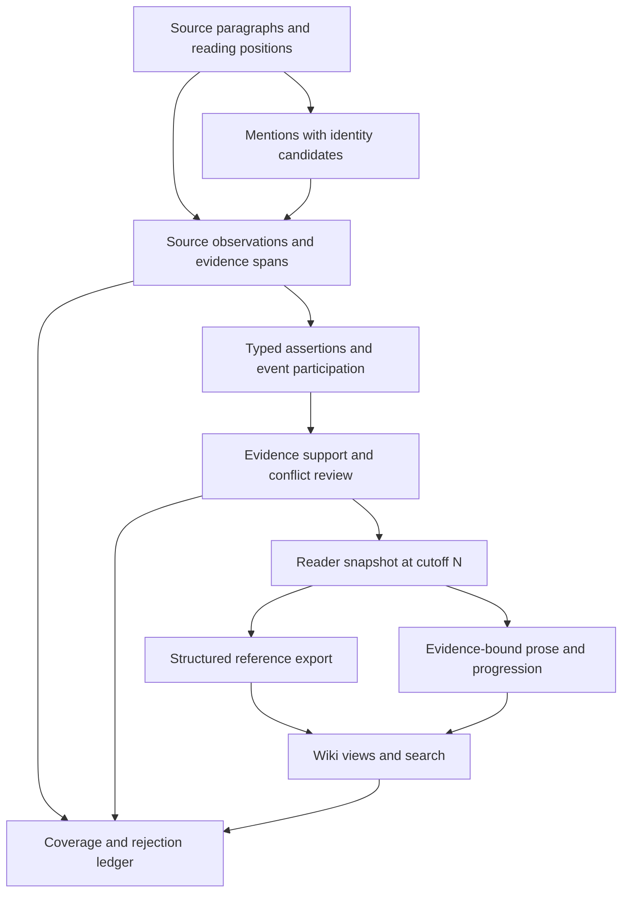

# Vision: an evidence-first, reader-scoped narrative reference

Date: 2026-09-24. Status: reviewed proposal; implementation pending.
Scope: **Spice and Wolf, volumes 1–2 only**.

This standalone vision answers the maintainer's request to assess the project's target,
diagnose implementation gaps, and propose a research-grounded route to professional quality.
It does not modify `VISION.md`, `CLAUDE.md`, `LOG.md` or protected `PHASE_*.md` records.
Its executable companion is [task 0007](0007-structured-wiki-quality.md).
All new measurements and observations are in [MEASUREMENTS §22](../../MEASUREMENTS.md).
Paper versions, exact sections used, reading depth, and transfer limits are in the
[research record](../../papers/reviews/0007-structured-wiki-quality.md).

## 1. Assessment

**The project has a useful foundation, but professional-grade structured information quality
has not yet been demonstrated.** Its strongest features are paragraph provenance, explicit
volume cutoffs, cached model calls, deterministic field rendering, and inspectable intermediate
artifacts. Keep these. A replacement with a generic GraphRAG stack would discard working
controls without addressing the demonstrated defects.

The next investment should be in representing, classifying, assigning and validating information.
Website polish cannot fix a suspected enemy becoming an unqualified enemy, an observation being
attached to the wrong identity, or a hypothetical becoming an assertion. Likewise, longer pages
and higher raw claim counts do not establish better coverage.

The current historical gold recall and precision figures are useful regression signals, not a
certificate of reference-work quality. Gold partly originated in fandom search transcription;
its scope judgments need paragraph witnesses. Its lexical scorer misses the new structured
abilities carrier, while its precision denominator does not include every emitted assertion.
The repository already documents a conditional Yarei gold fact that should not be asserted.
Repair this measurement contract before optimizing against it.

## 2. Product promise

For a reader who has finished volume N, provide the best-supported account that the text through
N permits: who entities are, what is known or merely reported about them, how they relate, what
happened, and what changed. A short accurate entry is a successful result when evidence is sparse.

Professional quality means:

- **Faithfulness:** the subject, category, relation direction, modality and evidence all agree.
- **Source-relative completeness:** important supported information can be found in a structured
  form; absent source evidence is distinguished from extraction or presentation loss.
- **Reader-bound knowledge:** later revelations do not change an earlier reader's names,
  classifications, asserted facts, confidence labels, recommendations or hidden metadata.
- **Coherent change:** reports, beliefs, hypothetical outcomes and actual changes are distinct.
- **Useful organization:** redundant paraphrases are grouped without erasing meaningful detail;
  facts and event participation connect entities only when evidence supports the connection.
- **Auditability:** every public assertion has a trace to supporting observations and source
  paragraphs, plus a visible internal disposition when withheld or disputed.

The primary deliverable is a **cutoff-safe structured reference dataset**. Markdown and HTML are
views of that dataset. Fandom remains a quality reference, never an evidence source or mandatory
section template. Personality, motivation and fear can remain concise prose in the reader view
while remaining individually traceable in the underlying data.

## 3. Evidence-backed diagnosis

Baseline: commit `0a9794e1ea8c4c43b64fd0b801a9281e16106b19`, saved artifact hashes in
[snapshot.json](../../eval/structured_wiki_snapshot_spice-and-wolf.json).
“Synthetic” below means a deterministic counterexample against current functions, not an
estimate of how often the defect occurs in the novels. Existing focused tests pass.

| Priority / issue | Evidence and cause | Consequence / direction |
|---|---|---|
| P0: evaluation measures the wrong universe | `eval/gold.py::_page_text` reads fields/prose/quotes but omits `traits`; `score_fact_precision` counts selected gold hits against selected forbidden relations. Synthetic ability recall is missed; an extra unjudged assertion does not reduce precision. | Add semantic fact-level and publication-level coverage; keep legacy metrics clearly labeled. Source-ground the evaluation set. |
| P0: polarity is lost or strengthened | Invalid `ExtractedFact` polarity defaults to asserted. Pair and codex projection do not share character-page polarity handling. Live Zheren/Lawrence pair loses the presumed label while retaining a “suspected” qualifier. | Quarantine invalid modality; share one publication policy for every surface. Preserve presumed/denied semantics in data. |
| P0: temporal reads disagree | `temporal.relations_at` does not filter interval ends, while `relations_between` does. `_relation_entries_between` copies future ends into public bundle metadata. Synthetic witnesses reproduce both. | Separate current/history APIs and scrub future endpoints centrally, including JSON and indexes. |
| P0: verification is not a shared, versioned publication decision | `_is_renderable` permits absent verdicts and ignores verdict cutoff. Stored historical verdict cutoffs are null. Character, trait, related, codex and pair readers implement separate checks. | Key review decisions to assertion/evidence/policy/cutoff; distinguish unreviewed from supported; test every public consumer. |
| P1: claim identity conflates different observations | `make_claim_id` excludes polarity, qualifier and occurrence; `_merge_claim` unions evidence but retains the first semantic fields. | Preserve source observations, then derive assertions with explicit equivalence. Do not let deduplication choose truth. |
| P1: volume is too coarse for narrative change | `_resolve_single_valued` groups by volume; the standing rule treats same-volume disagreement as extraction error and cross-volume disagreement as change. | A character can move, learn or change allegiance within one volume; a later passage can disclose an earlier event. Propose source-order and disclosure-aware state handling. This changes a standing semantic rule and needs explicit acceptance before implementation. |
| P1: ontology pressures incorrect assignments | Existing dev fixture includes INFLUENCE, REPUTATION, DEPICTION, NAMESAKE and PATRONAGE gaps. BACKGROUND can carry text but does not solve typed assignment. Traits expose SKILL/PERSONALITY overlap. | Add only witness-justified predicates, type/cardinality rules and explicit unmapped candidates; keep unsupported interpretations out of published fields. |
| P1: ambiguity is resolved too early | The mention automaton keeps the alphabetically first exact-surface claimant. `resolve_surface` can abstain, but cannot recover a discarded candidate upstream. Global alias grouping can carry future identity knowledge. | Preserve candidate sets and scope identity/alias evidence; resolve locally or abstain. Measure actual collision/misattribution cases before adopting a large coreference model. |
| P1: prose/event summaries have weaker evidence contracts | `graph/events.py` documents `beat_summary` as ungated; generated prose uses pooled citations. A verified graph does not verify a newly generated sentence. | Attach sentence/atom-to-evidence links and explicit support status; build progression from validated event/state records. |
| P2: deduplication is not semantic equivalence | The ledger's Holo skill comparison shows no cosine threshold separating duplicates from meaningful sound/scent differences. | Embeddings may propose candidate pairs; entailment/review must decide equivalence, directionality and preserved qualifiers. |
| P2: presentation heuristics can assert more than evidence | Image proximity and reuse caps do not identify depicted characters. Roster precedence can hide coexistence of roles/conflict. | Use only reviewed depiction links for portraits; keep association types and episode context in structured data. Do not invent connectivity. |

This review does **not** claim a fresh end-to-end accuracy rate, complete annotation of either
volume, or current live occurrence of every synthetic failure. The absence of denied claims in
the saved graph does not excuse a publication path that would mishandle one.

## 4. Intended architecture

### Source observations and semantic assertions

An observation records a source occurrence, exact evidence, resolved or unresolved participants,
extraction provenance, polarity/modality and attribution. It is not overwritten when another
passage disagrees. An assertion groups compatible observations under a typed proposition. The
state layer decides which assertions describe the current state, past state, an attributed belief
or an unresolved conflict. These are distinct operations with distinct error reports.

Keep current stable entity IDs internally; make reader-visible names and alias-equivalence claims
disclosure-scoped. Do not expose a future canonical slug as a supposedly harmless URL. Identity
revelations require evidence for the equivalence, not just an early occurrence of both strings.

### Reader knowledge and narrative time

Maintain at least these separate concepts:

- `disclosed_at`: where supporting information becomes available in reading order. This drives
  spoiler safety and retains `first_vol` as its volume projection.
- `source_position`: volume/chapter/paragraph order for observations and state changes.
- `valid_time`: only when explicitly supported; may be unknown, relative or tied to an event.
- `attributed_to` and `epistemic_status`: whose belief/report it is and what kind of statement it
  is. Reader knowledge must not be equated with a character's knowledge.

Do not turn this into mandatory character mind-reading. Begin with explicit statements and
known error cases. Store uncertainty instead of inferring a precise date or private belief.
The current same-volume/cross-volume contradiction rule remains in production until its
replacement is accepted and migration fixtures are ready.

### One publication boundary

Introduce a shared reader snapshot/projection API. It must return sanitized, eligible facts,
names, relationships, events and evidence, with consistent handling of current/history,
polarity and verification. Raw database queries remain available for audit tools only.

All reader-facing consumers use that projection: character pages, codex entries, pair pages,
timeline, source links, related links, front matter, navigation, search and serialized bundles.
Derived caches must depend on evidence, identity mapping, review policy and projection version.
Adding future input must not silently alter an earlier snapshot. Authorized corrections to
earlier extraction are explicit versioned corrections, not disguised narrative change.

Unreviewed is not supported. The proposed release mode withholds unknown/rejected assertions;
a separately marked diagnostic export retains them for repair. Decide that release policy before
changing existing permissive behavior. Deterministically validated facts need not each incur a
paid verification call; local scoring and reviewed fixtures remain the first options.

## 5. Research-informed choices

The exact paper-to-work-package mapping is in the research record; these are bounded adaptations,
not claims to have implemented or reproduced the papers.

- **CHIRON (2024), §4–5:** character/category questions can help discover nuanced facts, followed
  by validation. Adapt only as a targeted top-up after proving a source-supported gap. Its
  narrative-specific validation motivates calibrating our verifier; do not copy its ontology or
  train a model by default.
- **STAGE v9 (2026), §3.1.2, §3.2.1, §3.3:** preserve evidence-linked state developments and
  evaluate checkpoint changes separately from current state. Adapt progression and no-change
  controls; do not import its movie corpus or role-playing scope.
- **EvolvTrip v1 (2025), §3.3–3.4:** distinguish attributed mental states and their evolution.
  Adapt explicit belief/report qualifiers; its own limitations argue against treating inferred
  psychology as exhaustive factual triples.
- **E²RAG v1 (2025), §4:** keep context-specific entity occurrences connected to events. Adapt
  occurrence-to-event provenance within existing SQLite stores, not its complete retrieval stack
  or name-in-generated-summary linking heuristic.
- **MiniCheck (2024), §2 and Limitations:** evidence support is useful but does not establish
  absolute truth or distinguish every contradiction. Calibrate the existing local support path
  on attribution, negation, temporal and narrative context; retain human review for ambiguity.

No paper's headline performance is a target or a measurement of this project.

## 6. Order of work and success criteria

1. **Establish trustworthy measurement and regression witnesses.** Freeze current artifacts;
   evaluate extraction, classification, assignment, temporal interpretation, publication and
   citations separately. Extend task 0006's existing witness report instead of restarting it.
2. **Repair shared publication semantics.** Fix polarity, expired relations, future metadata and
   verdict reuse. Add tests across all consumers and future-input invariance tests.
3. **Preserve observations and model changes correctly.** Introduce schema versions, semantic
   identity and evidence-bound review records; trial within-volume changes in a shadow database.
4. **Repair taxonomy and entity resolution where witnesses justify it.** Classify, resolve and
   deduplicate existing evidence before paying to extract more.
5. **Recover genuinely missing supported information.** Run isolated prompt/top-up experiments
   on stored passages, following task 0006's existing holdout and approval boundaries.
6. **Publish coherent progression and provenance.** Derive per-volume change records and concise
   supported prose from the safe dataset; independently validate generated event summaries.
7. **Confirm once end to end on the authorized corpus.** Promote only after focused tests,
   reviewed precision/coverage comparison and cutoff checks pass.

Release gates are distinct: zero known high-severity attribution/polarity/spoiler failures in the
reviewed regression set; all published structured assertions have eligible evidence and review
status; missed source-supported facts and unresolved cases remain counted; no gains created by
duplicate paraphrases or relabeling unknowns. Report coverage and support with denominators,
sample scope and reviewer agreement. Passing a finite set is never a proof of universal safety.

## 7. Boundaries and decisions still needed

- This is an implementation plan, not authorization to expand beyond the existing series/volumes.
- Explicit acceptance is needed before replacing the standing contradiction semantics or changing
  default release handling of unreviewed facts. Fixtures and a shadow implementation can be
  prepared first; leave the conflict recorded rather than silently shipping a reinterpretation.
- Task 0006's passage-transfer approval remains separate from downloading public papers. This
  review neither spends it nor bypasses it. No new paid run is needed to begin the plan.
- Larger models, a new vector database, graph database migration, full-corpus coreference,
  multi-agent extraction, more volumes, more website sections and model training are deferred
  unless the measured bottleneck warrants them.

The first deliverable is an honest diagnostic and a shared publication boundary. Once those are
reliable, improvements in structured coverage will mean better information rather than a more
convincing presentation of the same errors.
